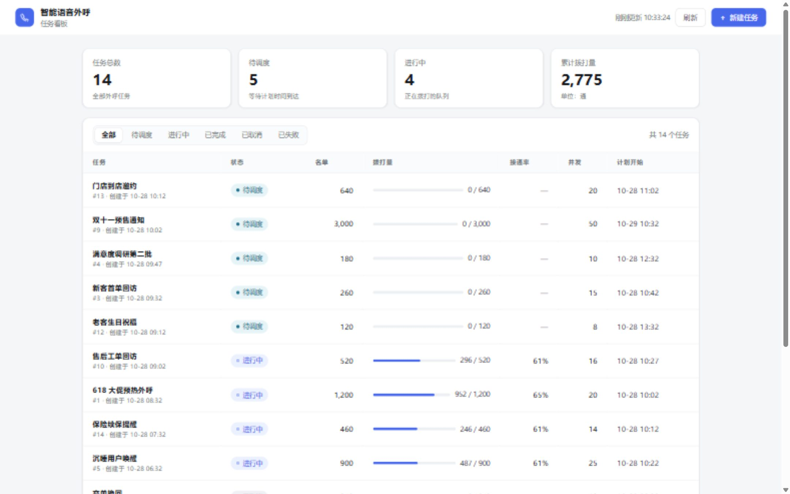
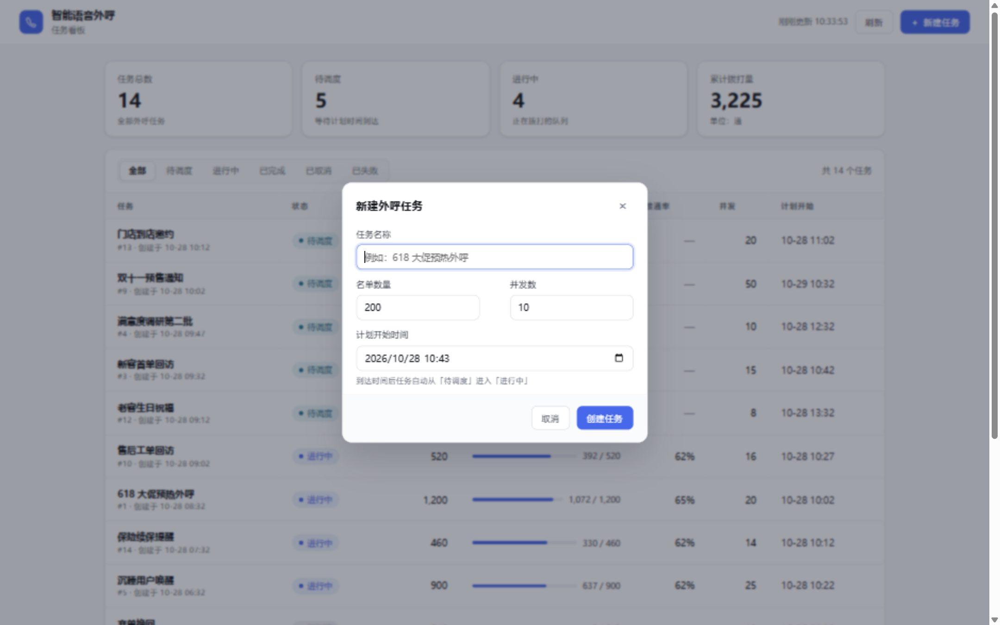
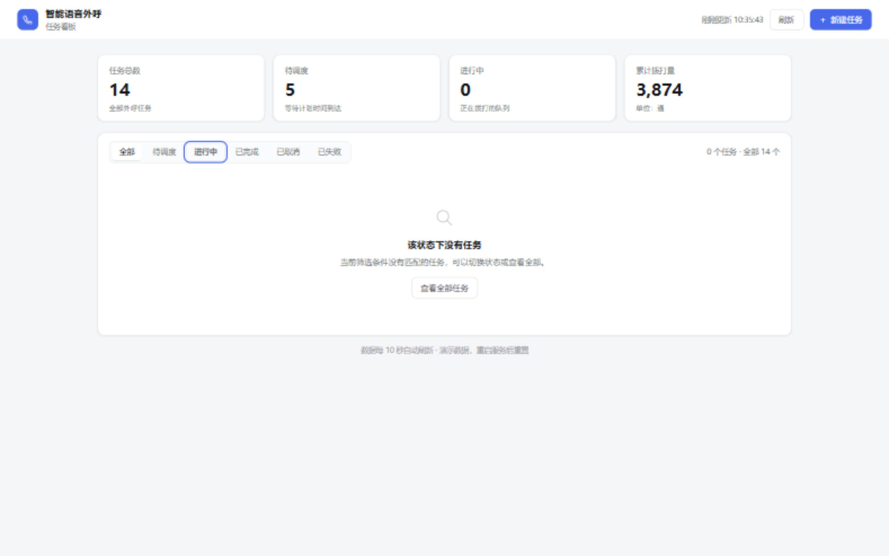
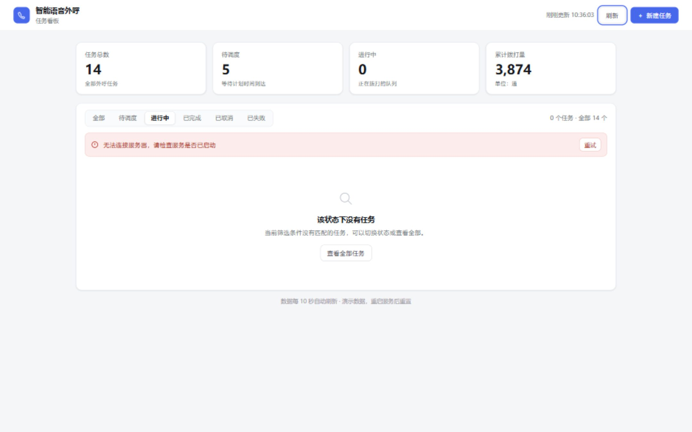

# 智能语音外呼任务看板

一个用 Java 实现的单页看板：展示自动外呼任务的执行情况，支持按状态筛选与新建任务。

**仓库**：<https://github.com/qwertyuio196875/smart-voice> · 提交说明见 [`SUBMISSION.md`](SUBMISSION.md)

## 截图



| 新建任务 | 筛选空态 | 错误态 |
| --- | --- | --- |
|  |  |  |

## 运行

```bash
mvn spring-boot:run
```

打开 <http://localhost:8080>。需要 JDK 21 与 Maven。

```bash
mvn test          # 11 个用例：状态推进、统计口径、创建校验、接口
mvn package       # 产出 target/smart-voice-0.0.1-SNAPSHOT.jar
```

## 功能

- 顶部四张统计卡片：任务总数、待调度、进行中、累计拨打量（前三张可点击筛选，再点一次取消）
- 任务列表：状态徽标、拨打量进度、接通率、并发数、计划开始时间
- 状态筛选（含「全局无任务」与「筛选无结果」两种空态）
- 新建任务弹窗：名称、名单数量、并发数、计划开始时间，字段级校验
- 首屏骨架屏、请求失败内联横幅 + 重试、创建成功 toast
- 每 10 秒自动轮询，后端每 5 秒模拟推进任务进度

## 技术

Spring Boot 3.5 · Java 21 · Thymeleaf · 原生 JS/CSS（无前端构建步骤）

| 接口 | 说明 |
| --- | --- |
| `GET /` | 看板页面 |
| `GET /api/tasks` | 全部任务 |
| `GET /api/stats` | 统计卡片数据 |
| `POST /api/tasks` | 创建任务（返回 201） |

## 说明

- 任务数据保存在进程内存，启动时写入 14 条种子数据，**重启后重置**
- 任务状态与统计口径的定义见 `GLOSSARY.md`
- 已取消 / 已失败为终态，当前只作为种子数据出现，界面不提供取消操作
